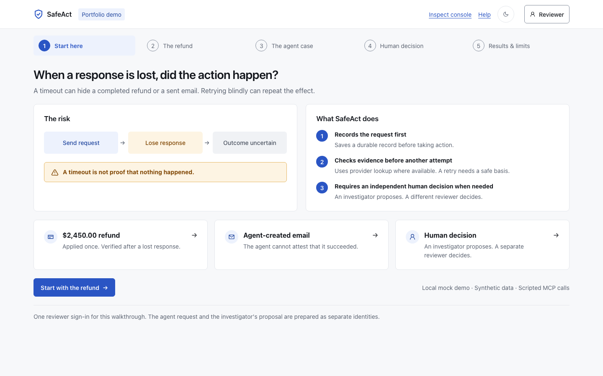
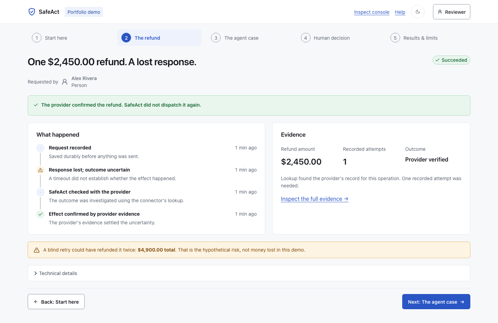
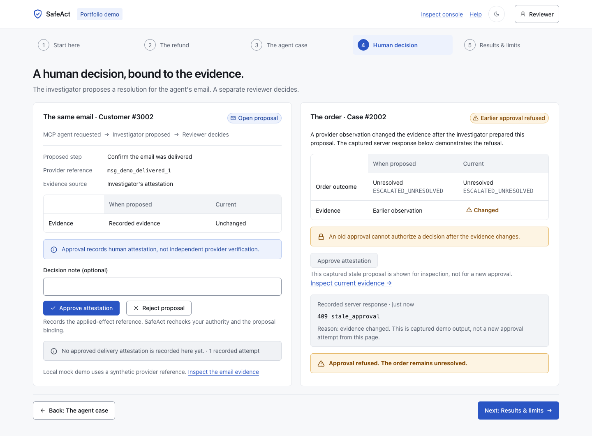
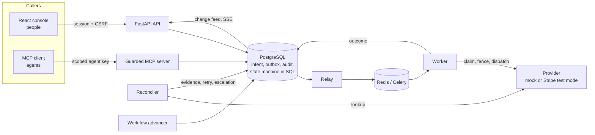

# SafeAct

[](https://github.com/DevaNuthakki/safeact/actions/workflows/ci.yml)

**When an AI agent or a person asks another system to refund a payment, send an email
or create a record, and the request times out, nobody knows whether it happened.
Retry and you may refund twice; give up and the customer may never be paid. SafeAct
records the action before sending it, checks with the provider instead of guessing,
and hands real uncertainty to a person.**

**SafeAct: 0 prohibited duplicate effects in 1,200 fault-injected scenarios.**
- **Simpler baselines:** on the scenarios each could run, they produced 92–371.
- **A robust conventional baseline (B3)** also produced 0. SafeAct matched it on every
  safety count.
- **Same scenarios, head to head,** SafeAct completed 861 of 874 achievable actions
  and B3 completed 841 ([results](#results)).

This was measured on one laptop, against mock providers and one Stripe test-mode
sandbox. It is not production evidence ([what this doesn't prove](#what-this-doesnt-prove)).

SafeAct is complete as a portfolio project and is not actively maintained.







*The guided walkthrough at `/demo` (local mock demo, synthetic data). See
[Run it locally](#run-it-locally) to open it yourself.*

**Read next:** [How it works](#how-it-works) · [When SafeAct retries](#when-safeact-retries) ·
[Results](#results) · [How it relates to Temporal and DBOS](#how-safeact-relates-to-temporal-and-dbos) ·
[What this doesn't prove](#what-this-doesnt-prove) · [Run it locally](#run-it-locally)

---

An execution-safety layer for actions that AI agents and people take on external
systems: refunds, CRM records, emails.

A timeout says something about the caller, not about the provider. The refund may have
failed, or it may have been applied with the response lost on the way back. Retrying
blindly can refund twice; giving up can lose the customer's money. SafeAct makes three
things hold within declared connector contracts:

- **No action runs twice where that is prohibited.** Every action is recorded durably,
  with a stable identity, before anything is sent.
- **Uncertainty stays visible.** An empty provider lookup is not proof of failure.
  SafeAct keeps such an action UNKNOWN, investigates, and escalates it to a person with
  its evidence instead of guessing.
- **Nobody acts outside their authority.** An agent can request and investigate, never
  approve. A human reviewer decides restricted recovery, bound to the exact version and
  evidence they were shown.

It is a portfolio project, evaluated end to end on one laptop. It is **not** a
production service: the production boundary is deny-only, and production execution is
not approved.

## Contents

- [How it works](#how-it-works)
- [Connector assumptions](#connector-assumptions)
- [When SafeAct retries](#when-safeact-retries)
- [Run it locally](#run-it-locally)
- [Running the tests](#running-the-tests)
- [Results](#results)
- [What this doesn't prove](#what-this-doesnt-prove)
- [What would close these gaps](#what-would-close-these-gaps)
- [What is not supported, and what stays unresolved](#what-is-not-supported-and-what-stays-unresolved)
- [Local coordination versus remote guarantees](#local-coordination-versus-remote-guarantees)
- [How SafeAct relates to Temporal and DBOS](#how-safeact-relates-to-temporal-and-dbos)
- [Known limits](#known-limits)
- [Evidence and reproduction](#evidence-and-reproduction)
- [License](#license)

## How it works



The processing path for one action:

1. **Admission.** The API (or MCP server) authenticates the caller. PostgreSQL then
   checks an exact grant for this tenant, actor, action, resource and contract, and
   stores the intent, a canonical payload hash, an audit row and an outbox event in one
   transaction. The provider idempotency key is derived server-side; a caller never
   chooses it. The same request key with a changed payload is refused (SAT22).
2. **Dispatch.** The relay publishes the outbox to Celery. A worker claims the
   operation (one owner, version-checked) and commits a DISPATCHING fence. Only then
   does it call the provider. A duplicate delivery stops at the claim.
3. **Outcome.** A clear provider answer is recorded as SUCCEEDED or FAILED_CONFIRMED.
   Anything ambiguous (a timeout, a 5xx after sending, a lost commit acknowledgement)
   becomes UNKNOWN, with a reason from a fixed vocabulary.
4. **Verification.** The reconciler looks the operation up at the provider within the
   contract's limits.
   - **Evidence of the effect** settles it as SUCCEEDED.
   - **Authoritative non-application** for every attempt is the only route to
     FAILED_CONFIRMED, or to a protected retry under the native key's retention.
   - **Anything else** escalates as ESCALATED_UNRESOLVED and keeps being checked.
     These checks are paced and bounded by the contract (the demo's mock contracts
     check every 10 s for 10 minutes after escalation): a check never resends, decisive
     evidence reopens verification, and after the bound only a reviewer-approved
     re-verification looks again.
5. **Review.** An investigator proposes REVERIFY, PROTECTED_RETRY or ATTEST_APPLIED. A
   different human reviewer decides once; a decision on a stale version is refused
   (409). Agents may propose REVERIFY or PROTECTED_RETRY only.

The state machine (RECORDED → CLAIMED → DISPATCHING → SUCCEEDED | FAILED_CONFIRMED |
UNKNOWN → VERIFYING → …) is enforced by PostgreSQL functions and constraints, not only
by application code. Every transition is an append-only log row. A fixed two-step
workflow (shipping charge, then replacement order, then a refund only after a
confirmed order failure) runs on the same machinery.

## Connector assumptions

Each connector has a versioned contract, registered in the database and attached to
every decision. SafeAct relies on what the contract states and nothing more.

| Connector | Native idempotency | Lookup | Side effect | What SafeAct may do after an ambiguous dispatch |
|---|---|---|---|---|
| Payments (mock) | Key bound to parameters, retained 24 h (1 h safety margin), safe for concurrent same-key requests | Strong (an `-eventual` contract variant also exists) | Reversible payment | Verify by lookup. Retry only with proof of non-application, or under the same key before retention − margin ([details](#when-safeact-retries)) |
| CRM (mock) | None | Eventual: stale or incomplete search | CRM record | Verify. An empty search never proves rejection, so it escalates |
| Email (mock) | None | None | Irreversible message | Escalate at once; never resend |
| Stripe test mode (real) | `Idempotency-Key` scoped to the account, 24 h assumed (1 h margin), parameters compared, 409 while executing | Eventual: lists refunds, matched by metadata | Reversible payment | As for payments |

**Mocks and real behaviour are kept apart:**
- **Mocks:** they are HTTP services with an append-only effects ledger. Only the
  evaluation harness reads the ledger; it is never a lookup endpoint.
- **Stripe:** it is reached through raw HTTPS with a pinned `Stripe-Version`, a
  restricted `rk_test_` key, an explicit opt-in flag and never from CI. A live-mode
  object stops the run.
- **Contracts in detail:** [docs/phase-d/stripe-sandbox-contract.md](docs/phase-d/stripe-sandbox-contract.md)
  and `core/connector_profiles.py`.

## When SafeAct retries

A retry is a second dispatch of the same operation. SafeAct makes one only when
PostgreSQL can show that the second dispatch cannot create a second effect. The
rule is the function `safeact_retry_basis` (migration 0007), and it allows a
retry on one of two grounds.

1. **Proof.** Every earlier attempt has authoritative evidence that it was **not**
   applied. Examples: the provider rejected the request before executing it, or an
   authoritative lookup proved non-application. An empty or inconclusive lookup is
   never proof.
2. **Same native key, inside its window.** The contract declares that the provider's
   idempotency key binds the request parameters and protects concurrent requests,
   and the retry reuses the server-derived key. The retry must also start before
   *first dispatch fence + key retention − safety margin*. For the payments and
   Stripe contracts that is 24 h − 1 h after the first DISPATCHING transition.

Rules that apply to every retry:
- **Any evidence that an attempt was applied rules out a retry.** The operation ends
  SUCCEEDED instead.
- **The ground is checked twice.** It is checked once when the operation becomes
  RETRY_ELIGIBLE, and again inside the transaction that commits the next DISPATCHING
  fence, immediately before the provider call (SAT12). A key window that expires
  between the two checks stops the retry.
- **Budgets are fixed per contract:**
  - attempts: payments and Stripe 3, CRM 2, email 1 (email is never resent);
  - abandoned claims: at most 3 per operation, where a worker claimed the operation
    and gave it up before dispatching;
  - exceeding either is refused (SAT13).
- **What happens when no retry is allowed:** with the budget spent, the operation
  escalates to a person. With no valid ground and no proof either way, it stays
  UNKNOWN or ESCALATED_UNRESOLVED and is checked for a bounded time.
- **Contract limits slow retries down** (F16, opt-in): backoff with jitter that
  honours `Retry-After`, a per-account circuit breaker and a token bucket. They
  only ever delay a retry. They never allow one.

**Some contracts need a reviewer's approval to retry (SAT27).**
- **Which contracts:** a contract's review policy can require one. In the demo that is
  the CRM contract. CRM has no idempotency key, so every retry is a new request, and
  even after a definite rejection someone accountable should confirm that a new attempt
  is still wanted.
- **How approval works:**
  - An investigator, or an agent, proposes PROTECTED_RETRY.
  - A human reviewer who is neither the proposer nor the requester approves it.
  - The approval is bound to the operation's current version and evidence, so a
    stale approval is refused.
  - The approval is added on top of the retry ground and the budget; it never
    replaces them.
- **If no approval arrives** before the investigation deadline, the operation ends
  FAILED_CONFIRMED (`retry_approval_expired`). That happens only when every attempt
  has system-recorded proof of non-application, never a human's word.

**How this compares with Stripe's guidance.** Stripe documents that "Retries with the same key return the saved response",
that keys can be removed "after they're at least 24 hours old", and that "We generate a new request if a key is reused after
the original is pruned" ([Stripe: idempotent requests](https://docs.stripe.com/api/idempotent_requests)). So a same-key retry
is safe inside that window, and SafeAct relies on exactly that. It adds three things:
- **A margin:** a 1 h margin below the 24 h Stripe states, so a retry never races the
  pruning.
- **A recorded window:** the window is measured from the durably recorded first fence,
  not from the client's memory.
- **No same-key retry past the window:** after it closes, a same-key retry would no
  longer be deduplicated, so SafeAct needs proof of non-application for every earlier
  attempt (in practice it escalates). A naive client that keeps retrying past 24 h
  would create a second refund. Fault family F09 tests this case.

## Run it locally

DEMO ONLY: synthetic accounts, mock providers, local machine.

**Everything in containers** (Docker with Compose v2):

```sh
cp .env.example .env && chmod 600 .env          # then set the two passwords in .env
docker compose --env-file .env -f deploy/compose.stack.yaml up --build --wait
```

- **Console:** <http://localhost:8080>. Sign in with a `demo-…` account (shown as demo
  personas such as Alex Rivera at Northwind (demo); names come from a demo directory in
  the console, matched to fixed demo principal ids, where a real deployment would
  resolve them through a tenant-scoped API) from:
  ```sh
  docker compose --env-file .env -f deploy/compose.stack.yaml exec api cat /state/demo-credentials
  ```
- **Agents:** they connect to `http://127.0.0.1:8002/mcp` with the `demo-*-agent` key
  from that file, as `Authorization: Bearer sak_…`.
- **Stop and remove:** `docker compose --env-file .env -f deploy/compose.stack.yaml down -v`.

Only the console and the MCP endpoint are published, on 127.0.0.1. Inside the stack,
every service shares one loopback, so the code's local-only guards apply unchanged.
`deploy/fresh_clone_check.sh` builds this stack from a fresh clone and smoke-tests it:
sign in, refund SUCCEEDED through REST and SSE, metrics up, MCP tools listed
([fresh-clone evidence](docs/phase-e/compose-v1/REVIEW.md)).

**Guided walkthrough** (the five-chapter story at `/demo`; DEMO ONLY). It needs the
container stack above running, plus Python 3.13 and Node 24 (`ui/.nvmrc`; `nvm use`
in `ui/` picks it up). From the repository root:

```sh
python3.13 -m venv .venv
.venv/bin/python -m pip install -r requirements-db.lock -r requirements-api.lock \
    -r requirements-mcp.lock
.venv/bin/python ui/scripts/prepare_walkthrough.py --compose   # submits any missing mock cases
cd ui && npm ci && SAFEACT_API_URL=http://127.0.0.1:8080 npm run dev
```

- Open <http://127.0.0.1:5173/demo>. The introduction and results are public; the
  three case chapters need the `demo-north-reviewer` sign-in. Its password is in the
  credentials file; print only that line with
  `docker compose --env-file .env -f deploy/compose.stack.yaml exec api cat /state/demo-credentials | grep '^demo-north-reviewer='`.
- Preparation reads the credentials in memory, uses the normal API and the scoped
  MCP server, and writes `ui/public/demo-cases.json` (operation and proposal ids
  only, git-ignored). It never resets the database or approves the email; that
  decision is left to the reviewer.
- The console on :8080 is built without that index, so its `/demo` chapters show
  "The demo cases are not available" with these steps. Rebuilding the demo
  database invalidates prepared ids: run the preparation again.
- Preparation alone creates every case the walkthrough needs, including the
  refused stale approval (409). The separate `deploy.demo.walkthrough` seed is only
  for the console script in [docs/demo-walkthrough.md](docs/demo-walkthrough.md).

**Try it yourself.** Sign in to the console at <http://127.0.0.1:5173/login?console=1>
(or :8080) as `demo-north-requester`, shown as Alex Rivera; print only its password
line with
`docker compose --env-file .env -f deploy/compose.stack.yaml exec api cat /state/demo-credentials | grep '^demo-north-requester='`.
Choose **New action**, then **Refund a charge**, and enter any amount up to $100,000.00.
Charge #1002 always loses the response after the refund is applied: SafeAct records
the outcome as unknown, checks with the provider and finishes with one attempt.
Charges #1001, #1003 and #1004 behave normally. Mock providers only; signing in as
Alex signs the reviewer out.

**Reset and reseed** (deletes all demo data):

```sh
docker compose --env-file .env -f deploy/compose.stack.yaml down -v
docker compose --env-file .env -f deploy/compose.stack.yaml up --build --wait
.venv/bin/python ui/scripts/prepare_walkthrough.py --compose
```

`down -v` removes this stack's four volumes (`pgdata`, `redisdata`, `promdata`,
`demo-state`): the demo database, broker data, demo metrics and the generated
credentials. They hold only demo data, which the next `up` rebuilds with new
passwords. Nothing else on the machine is touched.

**Development stack** (Python 3.13, Node 24, Docker for PostgreSQL and Redis):

```sh
python3.13 -m venv .venv
.venv/bin/python -m pip install -r requirements-db.lock -r requirements-broker.lock \
    -r requirements-api.lock -r requirements-mcp.lock -r requirements-obs.lock
docker compose --env-file .env -f deploy/compose.yaml up -d
.venv/bin/python -m alembic upgrade head
.venv/bin/python -m deploy.demo.bootstrap     # resets safeact_demo, writes .demo-credentials
.venv/bin/python -m deploy.demo.run_stack     # API :8000, MCP 127.0.0.1:8002
cd ui && npm ci && npm run dev                # console http://127.0.0.1:5173
```

**Where to go next:**
- **[Three-minute demo](docs/demo-walkthrough.md):** seed the cases with
  `python -m deploy.demo.walkthrough`, then follow the script. It includes an optional
  refund against Stripe test mode.
- **Faulty demo resources:** a few synthetic resources misbehave on purpose:
  - `ch_<tenant>_1002`: the response is lost after success;
  - `case_<tenant>_2002`: late commit, empty lookup;
  - `case_<tenant>_2003`: rejected; a retry needs a reviewer;
  - `case_<tenant>_2004`: permanently rejected;
  - `cust_<tenant>_3002`: the email is sent and the response is lost.
- **[Customer-support workflow](docs/demo/customer-support.md):** charge, then order,
  then a conditional refund.
- **[Local API example](examples/README.md).**

## Running the tests

These match what CI runs ([ci.yml](.github/workflows/ci.yml)). Run them from the
repository root unless a line says `cd ui`. The other suites and their opt-in flags
are listed in `CLAUDE.md`.

**Python 3.13 and Phase A** (the install line of CI's integration job; its Phase A job
installs the same without `requirements-test.lock`):

```sh
python3.13 -m venv .venv
.venv/bin/python -m pip install -r requirements-db.lock -r requirements-broker.lock \
    -r requirements-api.lock -r requirements-mcp.lock -r requirements-agent.lock \
    -r requirements-test.lock -r requirements-obs.lock \
    -r deploy/security/requirements-identity.txt
.venv/bin/python -m unittest discover -s tests/phase_a -t . -p 'test_*.py'
```

**Console checks** need Node 24 (`ui/.nvmrc`): `nvm install 24` then `nvm use` in
`ui/`, or the Node 24 installer from nodejs.org. Without installing it, put
`npx -y -p node@24 --` in front of each `npm` and `npx` command, for example
`npx -y -p node@24 -- npm ci --no-audit --no-fund`.

```sh
.venv/bin/python -m deploy.demo.export_openapi --check
cd ui && npm ci --no-audit --no-fund
npm run check:api && npm run typecheck && npm run lint && npm test && npm run build
```

**Browser tests** (Playwright) start their own throwaway stack on ports 8001 and 5173,
over the dev PostgreSQL and Redis:

```sh
cp .env.example .env && chmod 600 .env          # then set the two passwords in .env
docker compose --env-file .env -f deploy/compose.yaml up -d --wait
.venv/bin/python -m alembic upgrade head
docker compose --env-file .env -f deploy/compose.yaml exec -T postgres \
    psql -U safeact_dev -d safeact_dev -v ON_ERROR_STOP=1 -1 -q -f - \
    < deploy/security/provision_local_admission_role.sql
cd ui && npx playwright install chromium        # on Linux add --with-deps, as CI does
npx playwright test
```

Stop it with `docker compose --env-file .env -f deploy/compose.yaml down`; add `-v` to
also delete its database and broker data.

**Two copies on one machine:** both Compose files fix their project name
(`safeact-phase-b` for the dev stack, `safeact-stack` for the container stack), so a
second clone would reuse the first clone's containers and volumes. In the second clone:

- run `export COMPOSE_PROJECT_NAME=safeact-copy2` (any unused name) in each shell
  before `docker compose`. Passing `-p safeact-copy2` to every `docker compose` command
  also works, but the variable is the only form that reaches the scripts that run
  Compose themselves (`ui/scripts/prepare_walkthrough.py`, `chaos.load`);
- give its `.env` free host ports, since the first copy holds them:
  `SAFEACT_DEV_DB_PORT` and `SAFEACT_DEV_REDIS_PORT` (for example 55433 and 56380), and
  `SAFEACT_CONSOLE_PORT` / `SAFEACT_MCP_PORT` in the shell for the container stack;
- point the guided walkthrough at those ports, because its commands name the first
  copy's 8080 and 8002 (and `prepare_walkthrough.py` defaults to them, so without these
  flags it signs in and submits to the first copy's stack):
  ```sh
  .venv/bin/python ui/scripts/prepare_walkthrough.py --compose \
      --api http://127.0.0.1:$SAFEACT_CONSOLE_PORT --mcp http://127.0.0.1:$SAFEACT_MCP_PORT/mcp
  cd ui && npm ci && SAFEACT_API_URL=http://127.0.0.1:$SAFEACT_CONSOLE_PORT npm run dev
  ```
  and use `$SAFEACT_CONSOLE_PORT` wherever the README says `:8080`;
- the Toxiproxy ports (8474, 21000-21099, only with `--profile chaos`), and the browser
  tests' 8001 and 5173 are fixed: run those in one copy at a time;
- `down -v` with the same project name deletes only that copy's volumes.

## Results

All figures were measured on one laptop (MacBookPro15,1, i7-8850H, 12 CPUs, 32 GB,
macOS 15.4.1) against mock providers unless stated. They are observed counts within
the declared contracts, not probabilities and not a claim of exactly-once delivery.

### Fault-injected qualification (primary run v1, 2026-10-25)

1,200 seeded scenarios across all 16 fault families (F01–F16) and held-out adverse
combinations. Each scenario was run on SafeAct and four baselines: 6,000/6,000 rows,
0 harness errors, 5.07 h, $0 external cost.
- **The corpus, scoring rules and slot count** were frozen before any result existed.
- **The machine:** the run used 4 calibrated slots on an idle machine, plugged in,
  under `caffeinate`.

| Arm | Safety-failure rows | Prohibited duplicates | Orphans | Lost intents | False claims | Useful / achievable | N/A rows |
|---|---:|---:|---:|---:|---:|---:|---:|
| **SafeAct** | **0** | **0** | **0** | **0** | **0** | **924/937 (98.6%)** | 0 |
| B3: robust hand-built baseline (outbox, native keys, conservative reconciliation, manual escalation) | 0 | 0 | 0 | 0 | 0 | 841/874 (96.2%) | 63 |
| B2: native provider idempotency | 92 | 92 | 0 | 0 | 12 | 558/691 (80.8%) | 294 |
| B1: queue redelivery and retry | 239 | 213 | 0 | 0 | 25 | 426/691 (61.6%) | 294 |
| B0: bounded naive retry (intentionally incomplete) | 250 | 371 | 0 | 0 | 25 | 149/438 (34.0%) | 556 |

**How to read it:**
- **Duplicates** are counted per intended business action.
- **N/A rows:** an arm lacks the capability a family tests, for example human review
  (F14) or the agent boundary (F15). Those rows are excluded from its denominator and
  reported separately, never counted as passes.
- **By connector,** SafeAct completed CRM 367/367, email 139/139 and payments 418/431.
- **Coverage:** SafeAct observed all 28 of its applicable critical interleavings,
  including commit acknowledgements lost at claim, fence and outcome.
- **Load-suspect diagnostic:** the 169 baseline failures flagged by the frozen
  load-suspect rule all recurred on a 1-slot rerun, so load did not cause them.

**SafeAct's 13 missed completions (6 rows) are a declared trade-off.**
- **What happened:** a fixed attempt budget can be spent inside a 429 storm or a short
  outage. SafeAct then ends with proven non-application or escalates to a person, with
  0 effects. A luckier retry timing would have completed.
- **Not evaluated:** a candidate fix is to not count attempts the transport proves were
  never sent.

**Head-to-head with B3 on the same scenarios (post-hoc).** This analysis re-scores the
frozen run's committed rows with the frozen rules and runs nothing new. It sits beside
the headline above and does not replace it.

| On the 1,137 scenarios both arms run | Safety failures (every category) | Useful / achievable |
|---|---:|---:|
| SafeAct | 0 | **861/874 (98.5%)** |
| B3 | 0 | **841/874 (96.2%)** |

- **Separately, F15 (agent boundary):** 63 operations that only SafeAct runs. B3 has
  no agent surface. SafeAct completed 63/63 with 0 safety failures. That plus the
  paired 861/874 is the headline 924/937.
- **The whole usefulness gap is in F16, the 429-storm and short-outage scenarios.**
  Both arms stopped safely there, but B3 ended more refunds as confirmed "not applied"
  failures, so fewer of them finished. In one of those scenarios B3 finished more.
- Details: [paired review](docs/phase-e/qual-v1/paired/REVIEW.md).

More: [full-run review](docs/phase-e/qual-v1/full/REVIEW.md),
[diagnostic](docs/phase-e/qual-v1/diagnostics/REVIEW.md).

**Raw output:** about 1.2 GB (55 MB compressed). Its digests are committed in
[outside-repo.json](docs/phase-e/qual-v1/full/outside-repo.json). The compressed file,
the run log and the diagnostic's raw output are published as assets of the
[v1.0.0 release](https://github.com/DevaNuthakki/safeact/releases/tag/v1.0.0); how to
check them: [release assets](docs/phase-e/qual-v1/release-assets.md).

### Load test (M5.13, 2026-10-25)

Open-loop arrivals through the real API, with 8 requester sessions and 4 worker
processes. The mocks sit behind Toxiproxy with 20 ms added latency, and steps went from
10/s to 160/s for 30 s each.

| Offered | Admitted | Completed | Submit → accepted p99 | Submit → terminal p50 / p99 |
|---:|---:|---:|---:|---:|
| 10/s | 10.0/s | 10.0/s | 22 ms | 192 / 299 ms |
| 40/s | 40.0/s | 39.8/s | 24 ms | 284 / 439 ms |
| 80/s | 80.0/s | 47.7/s | 34 ms | 10.4 / 20.2 s (queue) |
| 160/s | 88.4/s | 32.1/s | 27.4 s | 79.1 / 126.6 s (queue) |

- **Safety:** 14,710 operations, 0 duplicate effects, 0 projection drift and none left
  unfinished.
- **Contention:** 0 deadlocks, 0 lock timeouts and 0 serialization failures. Every
  server-log error was an intended refused claim.
- **Saturation:** execution saturates at about 40–48 operations/s on this setup, and
  the single API process admits up to 120/s.
- **F16 under load:** the limiter held its 25 dispatches/s, and a breaker opened and
  closed around an injected 429 burst.
- **A measured cost:** under backlog the relay republishes still-claimable work about
  2.25 times per operation. The claim refuses the copies, so it is safe, but it costs
  capacity.

More: [load review](docs/phase-e/load-v1/REVIEW.md).

### Agents (Milestone 4, held-out)

The same tool-calling model (`gpt-4.1-mini-2025-04-14`) was given SafeAct's guarded MCP
tools in one arm and direct provider tools in the other. A deterministic caller on
SafeAct is a third arm. It ran 12 held-out scenarios × 6 trials per arm, on mock
providers with injected faults; these are observed counts, not rates. The total model
cost was $0.39.

| Arm (72 trials each) | Correct, strict rule (v1) | Correct, rule frozen before the held-out run (v2) | Unsafe effects executed | Orphan effects | False claims |
|---|---:|---:|---:|---:|---:|
| Model with SafeAct MCP tools | 66/72 | 71/72 | 0 | 0 | 0 |
| Same model, direct tools | 39/72 | 39/72 | 28 | 6 | 12 |
| Deterministic caller on SafeAct | 72/72 | 72/72 | 0 | 0 | 0 |

**Two scoring rules, both shown:**
- **v1 (strict)** accepts only the report each scenario lists.
- **v2** adds one rule. Where the expected outcome is escalation, either escalation
  status (`unresolved` or `needs_human_review`) is correct, for every arm, and neither
  ever counts as success.
- **When it changed:** v2 was adopted after the paid development calibration. It was
  committed at 17:37 UTC on 2026-10-20, 53 minutes before the held-out run started
  (18:30 UTC, run `20261020T183003Z-4771f9`), and the held-out manifest freezes it.
  The commit time comes from the private development history; the run id and the
  held-out manifest (`docs/phase-d/agent-eval-v1/heldout/manifest.json`, scoring version
  `agent-eval-scoring-v2`) are in this repository.
- **What it changes:** all 5 trials that change verdict are one scenario, AG1-H07,
  where the model reported `needs_human_review` and the scenario listed only
  `unresolved`.

**What the deterministic caller shows:** its 72/72 shows the value of the constrained
tools, not better model reasoning. The tools make the safe path the only path, so a
caller with no reasoning at all completes every scenario.

More: [agent evaluation](docs/phase-d/agent-eval-v1/README.md),
[both rules per trial](docs/phase-d/agent-eval-v1/heldout-combined/rescored.md).

### Stripe test mode (M5.8)

8 frozen scenarios × 2 repeats against a real Stripe sandbox: **16/16 PASS**, using 77
of a 150-call budget. Ground truth was Stripe's own refund list.

**What "Succeeded" means for a Stripe refund:**
- **What it confirms:** Stripe accepted the request and created the refund object.
- **The refund's own status** (`pending`, `requires_action`, `succeeded`, `failed` or
  `canceled`) is the value Stripe reported in its response at that moment. SafeAct
  records it as non-decisive detail, and the console shows it as "reported at the
  time". It is not a live value.
- **Out of scope:** settlement to the customer, and a refund that fails later. There
  are no webhooks.
- **Covered:** refund creation, a response lost after creation (verified, not resent),
  same-key replay, changed parameters, concurrent requests and refund-list visibility.
- **Not covered:** no 429 or outage was injected at Stripe, and retention expiry was
  tested on mocks only.

More: [sandbox review](docs/phase-d/stripe-sandbox-v1/REVIEW-M58.md).

### In one sentence (measured)

Built a durable external-action service with PostgreSQL, Celery and Redis. It was
evaluated on 1,200 fault-injected scenarios, each also run against four baselines
(6,000 runs in all). SafeAct had 0 observed prohibited duplicate effects, 0 orphan
effects, 0 lost intents and 924/937 achievable completions, including late provider
completion and worker crashes; the robust baseline B3 also had 0 safety failures.
It also has scoped MCP tools and a React review application with version-bound human
approval. With them, one model was correct in 66/72 held-out agent trials under the
strict rule (71/72 under the rule frozen before the run) with 0 unsafe effects,
against 39/72 and 28 unsafe effects with direct tools, across 12 held-out scenarios.

## What this doesn't prove

The results above are real, and they are narrower than "safe in production".
- **One laptop.** The qualification, the load test and every timing-sensitive family
  (lease expiry, late commits, backoff windows, worker kills) ran on one laptop over
  loopback, with load recorded per scenario. No multi-host network, clock skew between
  machines, or managed database failover was tested.
- **Mock providers plus one Stripe sandbox.**
  - Payments, CRM and email are mock HTTP services that behave as their contracts
    declare.
  - The only real provider is Stripe in test mode: 8 scenarios × 2 repeats, plus one
    demo run.
  - No 429, outage or retention expiry was injected at Stripe.
  - Real CRMs and email providers may behave in ways the mocks do not.
- **No production operation.** SafeAct has never run against real money or real
  customers. The production boundary is deny-only, with no TLS and no production SSO,
  and the demo uses synthetic accounts.
- **The author wrote the test material.** The 1,200 scenarios, the fault injectors,
  the scoring rules and all four baselines, B3 included, were written by the author.
  - They were frozen before any result existed.
  - Even so, a baseline built by someone else, or scenarios chosen by someone else,
    could change the picture.
- **The agent evaluation is small:** one model snapshot, 12 held-out scenarios and
  72 trials per arm. The results are observed counts, not rates.
- **Human review is not measured.** Escalations hand work to people. Their cost, how
  long a case takes to resolve, and how often reviewers get it wrong were not
  measured.
- **One operation per target for agents.** An agent cannot start a second distinct
  action on the same target, such as two partial refunds (SAT28). That needs the human
  path.
- **Worker identity binding is open.** JWT or session binding for workers is not
  implemented. It is closed on the human API path only.
- **Stripe success is acceptance, not settlement.** See
  [Stripe test mode](#stripe-test-mode-m58).
- **No universal exactly-once.** The claim is zero observed prohibited duplicate
  effects within the declared contracts and tested faults
  ([why](#local-coordination-versus-remote-guarantees)).

## What would close these gaps

These are not planned work. Each item would address one limit listed above.

- **One laptop, no production operation:** Deploy in a production-style setup (API,
  workers and database on separate machines, with TLS, backups and monitoring), then
  re-run the fault scenarios there.
- **Mock providers:** a connector-authoring guide or an installable library, then
  qualification against a real CRM and a real email provider.
- **Worker identity:** bind each worker to a verified identity, as human API requests
  are bound to a server-side session verified in PostgreSQL.
- **Stripe acceptance, not settlement:** track asynchronous refund outcomes (for example
  through webhooks), so a refund that fails after creation is recorded instead of
  staying "created".
- **One operation per target for agents:** a rule for distinct intents on one target
  (such as two partial refunds) instead of SAT28's single live operation.
- **Small agent evaluation:** more models, more held-out scenarios and enough trials to
  report rates rather than counts.
- **Human review not measured:** measure resolution time, reviewer effort and error
  rate with reviewers other than the author.

## What is not supported, and what stays unresolved

These are results, not hidden failures:

- **Expired idempotency retention (F09):** a payment whose native key has expired
  before any lookup answers is declared not completable. A retry would be unprotected,
  so the safe result is not to retry.
- **CRM late commit with an empty lookup:** escalated and checked periodically for a
  bounded time; a person or new evidence decides it. SafeAct never guesses.
- **Ambiguous email:** escalated at once and never resent. Only a human attestation
  with a provider reference can mark it delivered, and it is shown as reviewer-attested,
  never provider-verified.
- **F16 storms and short outages** can spend the attempt budget (above). The outcome
  is proven non-application or escalation, never a duplicate.
- **Asynchronous Stripe refund failure is out of scope:** there are no webhooks.
  "Applied" (and so SUCCEEDED) means Stripe accepted the request and created a refund
  object. The refund's own status is recorded as Stripe reported it at response time,
  as non-decisive detail. Settlement to the customer is not tracked.
- **Not exercised against real Stripe:** 429s, outages and retention expiry, which
  were tested on mocks only.

## Local coordination versus remote guarantees

SafeAct coordinates **locally** and strongly. One PostgreSQL database decides who owns
an operation, which transition is legal, and whether evidence is sufficient; it does
so in transactions, with version checks, fences and append-only history. A worker can
die, Redis can lose messages, and a commit acknowledgement can be lost: the durable
record still says what may happen next. All of these faults are in the tested corpus.

What happens at the **provider** is only as strong as its contract. SafeAct can
prevent a second dispatch where the provider offers no protection, and it can use a
native key's retention window to retry safely. It cannot make a provider without
idempotency exactly-once, see an effect that the provider's lookup does not show, or
undo an email. Where the remote side cannot give decisive evidence, SafeAct stops and
says so. The claim is therefore **zero observed prohibited duplicate effects within the
declared contracts and tested faults**, not exactly-once across arbitrary APIs.

## How SafeAct relates to Temporal and DBOS

**What workflow engines solve.** Durable workflow engines such as
[Temporal](https://temporal.io) and [DBOS](https://www.dbos.dev) make a multi-step
program survive crashes. They record its progress and retry failed steps. Both are
explicit that the external call inside a step can still run more than once:
- **Temporal:** "Because Activities may be retried, these functions may be executed
  more than once", and "You should always make your business logic Activities
  idempotent" ([Temporal: Activity Definition](https://docs.temporal.io/activity-definition#idempotency)).
- **DBOS:** "If a workflow fails while executing a step, it retries the step during
  recovery", and "Steps should be **idempotent**"
  ([DBOS: architecture](https://docs.dbos.dev/architecture)).

So making the external effect itself safe is left to the application.

**Where the conventional answer is enough.** If the provider has a native idempotency
key and the application is designed carefully (outbox, stable keys, conservative
reconciliation, manual escalation), duplicates are already prevented. That is what the
B3 baseline does, and it also had 0 safety failures here. SafeAct does not beat that
on safety. What it adds is at the edges such designs usually leave to ad-hoc code:
- **Outcomes that stay unknown.** UNKNOWN is a recorded state with evidence gates. An
  empty lookup is never treated as failure, and a retry needs proof or a valid key
  window, rechecked at the fence ([When SafeAct retries](#when-safeact-retries)).
- **Providers without native keys.** CRM and email get their own versioned recovery
  contracts: verify and escalate, never blindly resend.
- **Accountable human decisions.** A different human reviewer decides once. The
  decision is bound to the operation's version and evidence, so a stale decision is
  refused, and human attestation can only ever mark an effect as applied.
- **Bounded agent tools.** An agent can submit and investigate through scoped MCP
  tools, but it cannot approve, attest or force a retry.

**Alongside, not instead.** SafeAct could sit next to a workflow engine. The workflow
step, a Temporal activity or DBOS step, would submit the external action to SafeAct and
wait for its outcome. The engine owns the program's progress; SafeAct owns whether the
effect happened.

**Nothing here is a new distributed-systems technique.** It is a careful composition
of known ones: a transactional outbox, ownership fences with version checks,
provider idempotency keys, reconciliation by lookup, and an append-only audit log,
enforced in PostgreSQL.

## Known limits

The scope of the evidence, production, the agent per-target limit and worker
identity are covered in [What this doesn't prove](#what-this-doesnt-prove).
- **Other stated limits:** runtime error-log attribution, enforcing canonical JSON in
  SQL, and runtime credential/subject binding.
- **macOS:** the prefork worker forces `fork`. A worker crash on macOS is checked for
  fork safety before it is attributed to SafeAct. The qualification run recorded 0
  harness-error rows; its intended worker kills (F05) are faults, not crashes.
- **CI:** CI passed (private development history: PR #7, run 40252297269, commit `26e9761`): Phase A,
  PostgreSQL + broker integration, the isolated security suite and the console.
  `fresh-clone.yml` runs on a push to main and has passed on GitHub on every merge to main
  since Milestone 5 (private development history);
  locally it passed warm and cold. `qualification.yml` is manual and gated.
- **The full disclosure list** is in [docs/evidence-pack.md](docs/evidence-pack.md) and
  [docs/phase-e/observations.md](docs/phase-e/observations.md).

## Evidence and reproduction

This public repository starts from a snapshot; the development history is private. See the
note at the top of [docs/phase-e/status-log.md](docs/phase-e/status-log.md) for what that
means for commit, PR and run references.

- **[Evidence pack](docs/evidence-pack.md):** every blueprint acceptance check (A1–A12),
  demo item and definition-of-done bullet, linked to its file and test.
- **[Milestone 5 exit evidence](docs/phase-e/milestone-5-exit-evidence.md)** and the
  earlier phase exits linked from it.
- **Reproduce:**
  - every test suite, with its opt-in flag, is listed in `CLAUDE.md`;
  - qualification: `python -m chaos.qualify --manifest chaos/manifest_qual_v1.json --scope smoke|full`
    (gated; the frozen manifest refuses a changed tree);
  - load: `python -m chaos.load --out DIR`;
  - fresh clone: `deploy/fresh_clone_check.sh`.
- **Specification:** SafeAct Revision 2 blueprint, 15 October 2026
  ([docs/Project_1_SafeAct_Updated.pdf](docs/Project_1_SafeAct_Updated.pdf)).

## License

MIT, see [LICENSE](LICENSE). Icon path data follows Lucide (ISC) and Feather (MIT); their
notices are in [THIRD_PARTY_NOTICES.md](THIRD_PARTY_NOTICES.md). Quoted passages from
Stripe, Temporal and DBOS documentation remain their owners'.
