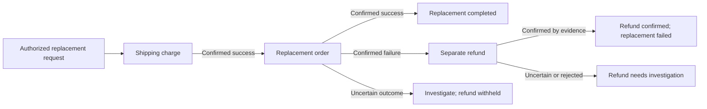

# SafeAct

Safe execution for AI customer-support actions.

A customer-support workflow charges a shipping fee and requests a replacement order. The order
request times out. Did it fail, or did the provider create the order and lose
the reply? Retrying or refunding immediately can make the situation worse.

SafeAct records the authorized request before dispatch, investigates uncertain
outcomes, and admits a separate refund only after a successful charge and a
confirmed order failure. The operator console follows the whole workflow and
links every step to its evidence. Agents can request actions; humans decide
restricted recovery proposals.



[Follow the customer-support demo](docs/demo/customer-support.md),
[integrate with the local API](examples/README.md), or
[inspect measured development outcomes](docs/demo/outcomes.md).

## Project status

Implementation in progress. Scoped agent-evaluation, Stripe sandbox and
development-test evidence is available; full system qualification and load
results are still pending.

## Objective

Build an evidence-based external-action execution system
that handles timeouts, uncertain provider outcomes,
duplicate delivery, and partial workflow completion.

## Core guarantees to evaluate

- Persist authorized intent before remote dispatch.
- Maintain stable operation identity across attempts.
- Never interpret an inconclusive lookup as proof
  that a provider action was not applied.
- Never automatically retry ambiguous work without
  a documented connector guarantee.
- Preserve uncertainty, evidence, and audit history.
- Enforce tenant authorization and human approval.
- Independently measure actual provider effects.

## Planned scope

- FastAPI backend and PostgreSQL durable state
- Celery workers with Redis
- Payments, CRM, and email connector profiles
- One real provider sandbox integration
- MCP interface and bounded tool-using agent
- React and TypeScript review application
- Fault injection and reproducible evaluation

## Engineering process

Implementation follows the SafeAct Revision 2
specification dated October 15, 2026.

Each phase must pass its acceptance gates before
its results can support a correctness claim.

## Current phase

**Milestone 5 (Phase E), M5.9 in progress:** a fault-injection harness using
separate worker processes, HTTP mock providers and Toxiproxy. M5.1–M5.8 are
committed: state projection, process stack, Stripe adapter and sandbox evidence,
provider backoff/limits, worker-kill tests, next-check display and metrics.
The harness now runs the real fixed workflow and scores forward and inverse
effects separately. The console can create and follow that workflow, including
separate refund evidence and investigation guidance. A runnable local API example
and a read-only outcomes report are available. Real F14 human-review and F15
agent-boundary drivers passed nine development cases, including three controls;
see the [independent evidence](docs/phase-e/dev-boundaries-20261022/REVIEW.md).
An independent B3 execution prototype now has its own PostgreSQL admission,
worker fencing, durable relay, reconciliation and pacing. Its tests use actual
local HTTP mocks and worker crashes. Building it also exposed a SafeAct lookup
timing bug; negative evidence is now rechecked after the response against the
original payment-key window. B3 now also has its own charge/order/refund workflow
and authenticated, version-bound human review. Separate inverse evidence,
single-use retry/lookup approvals and stale/concurrent decisions are exercised
through local PostgreSQL and HTTP. A read-only B3 database adapter now exposes
committed operations, audits, leases, recovery deadlines and native workflow
bindings to the common oracle. Process/fault and reviewer API adapters, plus
the full coverage/scoring review, remain open.
See the [execution development evidence](docs/phase-e/dev-baseline-execution-20261023/REVIEW.md)
and [workflow/review evidence](docs/phase-e/dev-baseline-workflow-review-20261023/REVIEW.md)
for their scope, retained cases and regression results.
The [database adapter evidence](docs/phase-e/dev-baseline-observer-20261023/REVIEW.md)
records local workflow checks and unchanged replay of earlier SafeAct results.

The saved Stripe sandbox run passed all 16 trials (8 scenarios × 2 repeats),
using 77 of the 150-call budget. This covers the declared test-mode experiment;
it does not establish production safety or full qualification. See the
[sandbox evidence review](docs/phase-d/stripe-sandbox-v1/REVIEW-M58.md).

Remaining: finish harness coverage and scoring, implement comparison baselines
B0–B3, freeze the corpus for STOP 2 review, then run qualification and load tests,
package the full Compose stack, and finish the demo and evidence pack. Full
qualification has not run.

**FINAL BIG QUALIFICATION RUN: NOT STARTED.** The author must review the
pre-run checkpoint and explicitly authorize this run. Development tests and
saved-results summaries do not constitute that run. Current work remains
uncommitted at the author's request.

**Milestone 4 (complete):** a guarded MCP server for AI agents and an agent evaluation.
- **Identity:** agents authenticate with scoped keys; identity, tenant and scope are derived in
  PostgreSQL on every tool call.
- **No approval for agents:** there is no approval tool, and only a human reviewer approves, in the
  console.
- **Provider text:** treated as untrusted input.

Earlier: Milestone 3, an authenticated API and React review console with version-bound human
approval. Local only, mock connectors and synthetic data; production execution is not approved.

**Evidence:**
- [Phase D evidence index](docs/phase-d/phase-d-exit-evidence.md) and
  [current recovery development results](docs/phase-e/dev-recovery-20261022/REVIEW.md);
- [Workflow/compensation development results](docs/phase-e/dev-workflows-20261022/REVIEW.md);
- `docs/phase-d/milestone-4-exit-evidence.md`, `docs/phase-d/mcp-authorization-review.md`,
  `docs/phase-d/agent-eval-v1/README.md`;
- `docs/phase-d/milestone-3-exit-evidence.md`;
- earlier phases: `docs/phase-b/phase-b-exit-evidence.md`, `docs/phase-c/phase-c-exit-evidence.md`.

### Agent evaluation results (held-out)

The same tool-calling model with SafeAct's guarded tools versus direct provider tools, plus a
deterministic caller on the same safety layer.

**Scope:**
- **mock providers with injected faults** (timeout after success, pending work, stale lookup, key
  expiry, denied access, malicious tool text, attempted self-approval, no-fault controls), synthetic
  tasks;
- **one model snapshot**, `gpt-4.1-mini-2025-04-14` (shuts down 2027-01-14);
- **6 trials per scenario per arm** over 12 held-out scenarios. These are **observed counts, not
  rates**; the trial count was limited by budget;
- scored under **both rules**: v2, with the original strict v1 in parentheses.

| Arm (72 trials each) | Correct v2 (v1) | Unsafe effects executed | Orphan effects | False claims |
|---|---|---|---|---|
| guarded model (SafeAct MCP tools) | 71 (66) | 0 | 0 | 0 |
| same model, direct tools | 39 (39) | 28 | 6 | 12 |
| deterministic caller (SafeAct) | 72 (72) | 0 | 0 | 0 |

**Ground truth** is an independent effects ledger, never a caller's report.

**Total model cost:** $0.39, across 3 calibration runs and 2 held-out runs.

**Every failure, the disclosures and the limits:** `docs/phase-d/agent-eval-v1/README.md`.

## Try it locally (DEMO ONLY)

Synthetic accounts and in-process mock providers; nothing reaches a
real provider. Requires Docker, Python 3.13 and Node 24.

On a fresh checkout, create `.env` from `.env.example`, set its local database
and Redis passwords, and run `chmod 600 .env`. Install the pinned dependencies:

```sh
python3.13 -m venv .venv
.venv/bin/python -m pip install -r requirements-db.lock -r requirements-broker.lock -r requirements-api.lock -r requirements-mcp.lock -r requirements-obs.lock
```

In the first terminal:

```sh
docker compose --env-file .env -f deploy/compose.yaml up -d   # .env from .env.example, chmod 600
.venv/bin/python -m alembic upgrade head
.venv/bin/python -m deploy.demo.bootstrap  # resets safeact_demo; writes .demo-credentials
.venv/bin/python -m deploy.demo.run_stack  # API :8000, MCP :8002, worker and recovery loops
```

In a second terminal:

```sh
cd ui && npm ci && npm run dev       # console on http://127.0.0.1:5173
```

Sign in with a `demo-` account from `.demo-credentials` (demo-only
passwords, regenerated on every bootstrap). A few synthetic resources
misbehave on purpose so the console can show uncertainty:
`ch_<tenant>_1002` (response lost after success), `case_<tenant>_2002`
(late commit, empty lookup), `case_<tenant>_2003` (rejected; retry
needs a reviewer) and `cust_<tenant>_3002` (email sent, response lost).

Choose **Send a replacement** to follow charge → order → conditional refund.
Use `case_<tenant>_2001` for a clean order, `case_<tenant>_2004` for a permanent
order rejection and separate refund, or `case_<tenant>_2002` for an uncertain
order whose refund is withheld. The admission fixes and new `2004` grant require
a demo bootstrap if your demo environment predates them; bootstrapping resets demo history and
regenerates its credentials. See the [walkthrough](docs/demo/customer-support.md).

Agents connect to the guarded MCP server with the `demo-*-agent` key
from `.demo-credentials` as `Authorization: Bearer sak_...`. The tools
are submit_action, get_action_status, inspect_evidence,
request_verification and propose_resolution. There is no approval tool:
only a human reviewer approves, in the console.

## Tests

See `CLAUDE.md` for every suite and its opt-in flag; CI runs them all.
